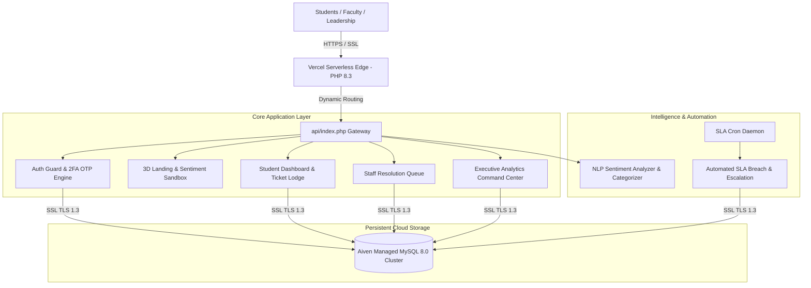

<div align="center">

# ⚡ FeedPulse AI
### Next-Gen Autonomous Campus Governance & Sentiment Intelligence System

[](https://feedpulse-ai.vercel.app)
[](https://php.net)
[](https://aiven.io)
[](https://threejs.org)
[](#-security--hardening)
[](LICENSE)

<br/>

**Your Voice. Accountable Action. Automated by AI.**  
FeedPulse AI bridges students, faculty, and university leadership with real-time NLP sentiment analysis, guaranteed Service Level Agreement (SLA) resolution timers, automated multi-tier escalation, and cryptographic whistleblowing protection.

[Explore Live Demo](https://feedpulse-ai.vercel.app) · [Report Bug](https://github.com/Nishant2007git/feedpulse-ai/issues) · [Request Feature](https://github.com/Nishant2007git/feedpulse-ai/issues)

</div>

---

## 📸 Overview & Design Philosophy

FeedPulse AI is built using **Design System v3.0**:
- **Deep Space Obsidian Palette:** Seamless `#030712` canvas with ambient dual floating glow orbs (`#6366f1` Indigo & `#06b6d4` Cyan).
- **Interactive Three.js 3D WebGL Visualization:** Real-time sentiment core surrounded by dual orbital rings and pulsating telemetry nodes.
- **Glassmorphic UI & Micro-interactions:** Multi-layered blurred backdrops (`backdrop-filter: blur(16px)`), luminous borders, and hover micro-animations.
- **Institutional Transparency:** Role-tailored experiences for Students, Department Staff, and University Executive Leadership.

---

## 🏛️ System Architecture



---

## ✨ Key Capabilities

### 1. 🤖 Real-Time NLP Sentiment Triage
- Instant client-side + server-side keyword sentiment evaluation (`Positive`, `Neutral`, `Urgent`, `Critical`).
- Dynamic category auto-tagging (Academics, Facilities, Hostel, Administration, Safety).
- Interactive Live AI Sandbox directly in the hero banner.

### 2. ⏱️ SLA Lifecycle & Escalation Engine
- Automatic deadline calculation per department priority metrics.
- Color-coded live countdown timers with remaining percentage indicators.
- Automated CLI cron daemon (`cron/check_sla.php`) scanning tickets for deadline breaches, auto-escalating priority to `CRITICAL`, and dispatching executive alerts.

### 3. 🎭 Cryptographic Anonymous Whistleblowing
- Complete identity separation when "Submit Anonymously" is selected.
- Zero database storage of `user_id` or session fingerprint in anonymous feedback entries.
- Students can voice sensitive campus concerns without fear of academic retaliation.

### 4. 🏆 Civic Engagement Gamification
- Dynamic student engagement scoring system:
  - `+10 Points` for verified constructive feedback
  - `+15 Points` for lodging actionable grievances
  - `+5 Points` for completing post-resolution satisfaction surveys
- Tier Progression: **Bronze &rarr; Silver &rarr; Gold &rarr; Platinum**.

### 5. 🛡️ Enterprise-Grade Security
- **2FA OTP Verification:** SHA-256 hashed OTPs with strict 10-minute expiry and attempt ratelimiting.
- **Strict Prepared Statements:** 100% parameterized SQL queries through PDO eliminating SQL injection.
- **CSRF Token Rotation:** Session-bound cryptographic tokens protecting every state-modifying POST request.
- **Hardened Cookies:** `HttpOnly`, `SameSite=Lax`, `Secure` session cookies with `session_regenerate_id()` on authentication.
- **Security Headers:** Enforced `Content-Security-Policy`, `X-Frame-Options: SAMEORIGIN`, `X-Content-Type-Options: nosniff`, and `HSTS`.

---

## 👥 Multi-Role User Workflows

```
┌────────────────────────────────────────────────────────────────────────┐
│                        FEEDPULSE AI ECOSYSTEM                          │
├─────────────────┬──────────────────────┬───────────────────────────────┤
│ 🎓 STUDENT      │ 🛠️ STAFF / FACULTY   │ 👔 ADMIN & LEADERSHIP         │
├─────────────────┼──────────────────────┼───────────────────────────────┤
│ • Lodge Ticket  │ • Claim Tickets      │ • Real-time Campus Analytics  │
│ • Anonymous Box │ • Resolution Notes   │ • Department SLA Audit        │
│ • Live Status   │ • Status Transition  │ • Feedback Moderation         │
│ • Rate Response │ • Internal Handoff   │ • User Management & 2FA       │
│ • Engagement XP │ • Priority Overwrite │ • Export Compliance Reports   │
└─────────────────┴──────────────────────┴───────────────────────────────┘
```

---

## 🔑 Demo Access Credentials

The demo database is pre-seeded with accounts for all platform roles:

> **Universal Password:** `password`

| Role | Email Address | Access Scope |
| :--- | :--- | :--- |
| **Super Admin** | `superadmin@feedpulse.edu` | Full command center, moderation, analytics, 2FA protected |
| **Admin** | `admin@feedpulse.edu` | Department triage, ticket resolution supervision |
| **Staff** | `staff.cs@feedpulse.edu` | Computer Science resolution desk & ticket claiming |
| **Student** | `student@feedpulse.edu` | Student portal, engagement badges, complaint submission |

*💡 In development mode, the 2FA verification screen displays an instant quick-fill helper for convenience.*

---

## 🛠️ Tech Stack & Dependencies

| Layer | Technologies |
| :--- | :--- |
| **Backend Runtime** | PHP 8.2 / 8.3 (Strict types, PDO MySQL, cURL) |
| **Database** | Aiven Cloud MySQL 8.0 (Managed, TLS/SSL Required, UTF8mb4) |
| **Frontend UI** | HTML5, Modern CSS Variables, Bootstrap 5.3, Bootstrap Icons |
| **3D & Graphics** | Three.js (WebGL Holographic Sentiment Sphere) / Spline Viewer |
| **Data Viz** | Chart.js 4.x (Real-time category & resolution graphs) |
| **Hosting & CI/CD** | Vercel Edge Serverless (`vercel-php@0.7.3`) + GitHub Actions |

---

## 🚀 Local Installation & Setup

### Prerequisites
- PHP 8.2 or higher
- MySQL 8.0 or MariaDB 10.4+
- Composer (optional)

### 1. Clone the Repository
```bash
git clone https://github.com/Nishant2007git/feedpulse-ai.git
cd feedpulse-ai
```

### 2. Environment Configuration
Copy `.env.example` to `.env` and fill in your local database details:
```bash
cp .env.example .env
```
Edit `.env`:
```ini
APP_NAME="FeedPulse AI"
APP_ENV=development
APP_URL=http://localhost:8000

DB_HOST=127.0.0.1
DB_PORT=3306
DB_NAME=feedpulse_ai
DB_USER=root
DB_PASS=
DB_SSL=false
```

### 3. Initialize Database
Import schema and seed data into MySQL:
```bash
mysql -u root -p -e "CREATE DATABASE feedpulse_ai;"
mysql -u root -p feedpulse_ai < database/feedpulse.sql
```
*(Alternatively, navigate to `http://localhost:8000/database/setup.php` in your browser)*

### 4. Start Local Server
```bash
php -S localhost:8000
```
Open [http://localhost:8000](http://localhost:8000) in your browser!

---

## ⏰ Automated SLA Daemon

To execute the SLA breach checker and auto-escalate overdue tickets:
```bash
php cron/check_sla.php
```
*In production, schedule this script via `cron` or Windows Task Scheduler to run every 15 minutes:*
```cron
*/15 * * * * /usr/bin/php /var/www/feedpulse-ai/cron/check_sla.php > /dev/null 2>&1
```

---

## 📁 Project Structure

```
feedpulse-ai/
├── admin/                  # Executive leadership & moderation portal
│   ├── analytics.php       # Live visual Chart.js dashboards
│   ├── complaints.php      # University-wide grievance triage
│   ├── dashboard.php       # Admin command center
│   ├── feedback-moderation.php
│   └── users.php           # User & role management
├── api/                    # Serverless endpoints
│   ├── index.php           # Vercel serverless request router
│   ├── ai-sentiment.php    # Real-time NLP sentiment analysis
│   ├── analytics.php       # Real-time metrics endpoint
│   └── notifications.php   # User notification feed
├── assets/                 # Client assets
│   ├── css/feedpulse.css   # Obsidian Design System v3.0 styles
│   └── js/hero-3d.js       # Three.js holographic sentiment sphere
├── config/                 # Core configs (Database, Mail, App)
├── cron/                   # Automation daemons (SLA checker)
├── database/               # SQL migrations & schema seeders
├── includes/               # Security, Auth, Logging & Helper libraries
├── staff/                  # Department resolution workspace
├── student/                # Student ticket lodge & engagement portal
├── index.php               # High-converting 3D landing page
├── login.php               # Multi-role authentication & OTP gate
├── verify-otp.php          # 2FA verification engine
└── vercel.json             # Vercel serverless build & routing configuration
```

---

## 🤝 Contributing

Contributions are welcome! Please follow these steps:
1. Fork the Project (`git checkout -b feature/AmazingFeature`)
2. Commit your Changes (`git commit -m 'Add AmazingFeature'`)
3. Push to the Branch (`git push origin feature/AmazingFeature`)
4. Open a Pull Request

---

## 📄 License

Distributed under the **MIT License**. See `LICENSE` for more information.

<div align="center">
  <sub>Engineered with ❤️ for institutional accountability and modern campus governance.</sub>
</div>
